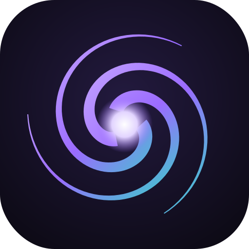

<p align="center"></p>

# Vortex v0.2.1

**Muito mais que um chatbot. Um universo de possibilidades.**

Vortex is a personal AI that runs entirely on your own machine: its own models, its own API, its
own interface. No third-party API keys, no telemetry, no cloud.

The repository has two parts:

| Part | What it is | Where |
|---|---|---|
| **Vortex GPT** (original) | A small GPT-style transformer written and trained from scratch, with a Flask chat, terminal chat and Windows desktop app. | `vortex/`, `train.py`, `server.py`, `chat.py`, `app.py`, `web/` |
| **Vortex Platform** (new) | A self-hosted AI platform: FastAPI backend with an OpenAI-compatible API, model registry, local LLM serving, and a Next.js interface (in progress). | `apps/`, `models/`, `infra/`, `docs/`, `compose.yaml` |

The platform serves two models of its own, both labeled **PRÓPRIO**:

| Model id | What runs it | Good for |
|---|---|---|
| `vortex-v0.2.1` (default) | `vortex:0.2.1`, built locally in Ollama from open weights (Qwen 2.5 / Llama 3.2) plus the Vortex identity (`models/Modelfile`). Fine-tune it with `models/finetune`. | General chat, code, analysis; RAG, tools and agents in later steps |
| `vortex-native` | The from-scratch GPT in `vortex/`, trained by `python train.py` on your conversations in `data/` | Your fully self-made model |

See [docs/architecture.md](docs/architecture.md) for the design and the roadmap.

---

## Vortex Platform

### Requirements

| | Minimum | Recommended |
|---|---|---|
| RAM | 8 GB (3B model) | 16–32 GB (7B model) |
| Disk | 5 GB | 15 GB |
| GPU | none (CPU works) | NVIDIA 8 GB+ VRAM |
| Software | Python 3.11+ and [Ollama](https://ollama.com), or Docker | |

### Option A: run on your notebook (Windows, no Docker)

```powershell
# 1. Build the Vortex model in your local Ollama (uses llama3.2:3b, fast on CPU)
.\scripts\create-model.ps1

# 2. (optional) Train the from-scratch GPT so vortex-native works
pip install -r requirements.txt
python train.py

# 3. Start the API at http://127.0.0.1:8000  (Swagger UI: /docs)
.\scripts\run-api.ps1                # add -Lan to reach it from your phone/other PCs
```

On a 3B model a CPU-only notebook answers at a few tokens per second. Use a 7B base
(`.\scripts\create-model.ps1 -Base qwen2.5:7b-instruct-q4_K_M`) when you have 16 GB+ RAM.

To use `vortex-native` in the API, install PyTorch into the API environment:
`pip install -e "apps/api[native]"`.

### Option B: Docker (one command)

```bash
cp .env.example .env
docker compose up --build
```

On first start, `ollama-init` downloads the base model (about 5 GB) and builds `vortex:0.2.1`.

- API: http://localhost:8000 (docs at `/docs`)
- Web: http://localhost:3000

Profiles: `--profile postgres` (Postgres instead of SQLite), `--profile llamacpp` (serve a GGUF
fine-tune), and `-f infra/compose/gpu.yaml` for NVIDIA GPUs (adds the `vllm` profile).

All ports bind to `127.0.0.1`. Nothing is exposed to your network unless you change it.

### Using the API

No API key needed. The API follows the OpenAI request format, so existing apps and SDKs can talk to
**your** server by changing the base URL. Requests never go to OpenAI or anyone else.

```bash
# models
curl http://localhost:8000/v1/models

# chat
curl http://localhost:8000/v1/chat/completions \
  -H "Content-Type: application/json" \
  -d '{"model": "vortex-v0.2.1", "messages": [{"role": "user", "content": "Olá, Vortex!"}]}'

# streaming (SSE). The completion id is in the X-Vortex-Completion-Id header.
curl -N http://localhost:8000/v1/chat/completions \
  -H "Content-Type: application/json" \
  -d '{"model": "vortex-native", "messages": [{"role": "user", "content": "oi"}], "stream": true}'

# stop a running generation
curl -X POST http://localhost:8000/v1/chat/completions/<completion-id>/cancel

# embeddings (needs: ollama pull nomic-embed-text)
curl http://localhost:8000/v1/embeddings \
  -H "Content-Type: application/json" -d '{"input": "Olá mundo"}'
```

JavaScript:

```js
const res = await fetch("http://localhost:8000/v1/chat/completions", {
  method: "POST",
  headers: { "Content-Type": "application/json" },
  body: JSON.stringify({ messages: [{ role: "user", content: "Olá!" }] }),
});
console.log((await res.json()).choices[0].message.content);
```

Other endpoints: `GET /health`, `GET /api/health` (model backend status), `GET /api/models`
(names, badges, descriptions for the UI), `GET /api/usage` (tokens, latency, tokens/s).

### Adding a model version

Edit [models/registry.yaml](models/registry.yaml); no code changes. There's a commented example
for `vortex-v0.3`. Every value accepts `${ENV_VAR:-default}`.

### Development and tests

```bash
cd apps/api
python -m venv .venv && .venv/Scripts/activate     # Linux/macOS: source .venv/bin/activate
pip install -e ".[dev]"
pytest              # 48 tests; no model needed (fake backends)
ruff check .
VORTEX_MOCK_BACKEND=true uvicorn vortex_api.main:create_app --factory --reload   # simulated answers
```

Web app:

```bash
cd apps/web
npm install
npm run dev         # http://localhost:3000
```

### Roadmap

1. ✅ Repo scaffold + docker compose (web, api, ollama, db)
2. ✅ Model serving + OpenAI-compatible `/v1` API with streaming, cancel, usage, rate limit
3. ⏳ Core chat UI (sidebar, composer, streaming messages, history) + accounts (argon2)
4. Right panel, projects, usage dashboard, settings
5. File upload, OCR, RAG, memory
6. Tools: web search (SearXNG), image generation, code sandbox
7. Agents and automations
8. Video generation, library, explore, polish
9. v1.0

---

## Vortex GPT (from scratch)

A decoder-only transformer written in PyTorch and trained character by character on your own
conversations.

- Character-level tokenizer with special chat tokens
- Loss computed only on Vortex's replies, so it learns to answer instead of imitating you
- Data augmentation for user messages (case, accents, punctuation)
- Streaming web chat (Flask), terminal chat, and desktop app (pywebview)
- Windows builds through GitHub Actions
- Runs on CPU, CUDA or Apple Silicon (MPS)

### Setup

```bash
python -m venv .venv
source .venv/bin/activate        # Windows: .venv\Scripts\activate
pip install -r requirements.txt
```

### Train

```bash
python train.py
python train.py --max-steps 5000 --learning-rate 1e-3
python train.py --n-layer 6 --n-embd 256 --n-head 8
python train.py --resume --max-steps 2000
```

The model and tokenizer are saved to `checkpoints/`. The platform API picks them up automatically
as `vortex-native`.

### Chat

```bash
python server.py     # web chat at http://127.0.0.1:5000
python chat.py       # terminal
python app.py        # desktop app (pip install pywebview)
```

### Windows build

Every push to `main` runs `.github/workflows/build.yml`, which trains the model, packages Vortex
with PyInstaller and uploads `Vortex-windows-x64` as an artifact. Pushing a tag like `v1.0.0` also
publishes the zip as a GitHub release.

To build locally on Windows:

```bash
pip install pyinstaller pywebview
python train.py
pyinstaller app.py --name Vortex --windowed --icon assets/icon.ico --add-data "web;web" --add-data "assets;assets" --add-data "checkpoints;checkpoints" --collect-submodules webview
```

A `checkpoints` folder placed next to `Vortex.exe` overrides the bundled model.

### Teaching Vortex

Add `.txt` files to `data/`. Every file in that folder is used for training.

```
> what the user says
< what Vortex answers
---
> a new conversation starts after ---
< answer
```

---

## Project layout

```
apps/
  api/            FastAPI platform backend (OpenAI-compatible /v1 + /api)
  web/            Next.js interface
models/
  registry.yaml   model ids → backends (Ollama, llama.cpp, vLLM, native)
  Modelfile       builds vortex:0.2.1 in Ollama
  prompts/        Vortex identity and tone
  finetune/       LoRA/QLoRA (Unsloth, Axolotl) → GGUF
infra/            Dockerfiles, compose overrides, Ollama init
scripts/          Windows helpers (create-model.ps1, run-api.ps1)
docs/             architecture
vortex/           from-scratch GPT (config, tokenizer, model, data, engine)
train.py          training script
server.py         Flask web chat
chat.py           terminal chat
app.py            desktop app launcher
web/              Flask chat interface
data/             training conversations
checkpoints/      trained model (git-ignored)
```

## License

MIT
